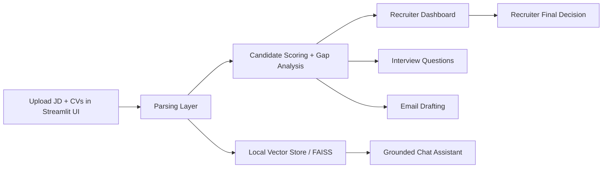

# AI-Powered Recruiter Chatbot

A synthetic, grounded recruiter assistant for CV-to-job matching, gap analysis, interview preparation, and recruiter Q&A.

## Project overview

This project ingests job descriptions and candidate CVs, ranks candidates against a role, highlights skill gaps, generates interview questions, drafts email templates, and answers recruiter questions from the provided records only. The system is intentionally grounded: when something is not present in the uploaded data, it returns "Information not available in provided records." instead of inventing facts.

## Architecture



## Tech stack

- Python 3.11+
- Streamlit for the web UI
- LangChain + FAISS for retrieval and grounding
- Google Gemini for structured outputs and generation (when API key is configured)
- Pydantic for validation and schema enforcement
- PyPDF for PDF extraction
- python-dotenv for environment configuration

### Model selection justification

This repo uses Gemini models with a fallback heuristic engine when no API key is configured. It uses Gemini 2.5 Pro for candidate-to-job matching and Gemini 2.5 Flash for chat, interview questions, and email drafting. This setup is practical for production-like demos because it gives:

- structured JSON outputs with schema validation
- cleaner recruiter-facing summaries and generated questions
- the ability to run demos offline when the API is unavailable

The fallback logic keeps the project usable for local testing while still enabling stronger LLM-assisted output when configured.

## Repository structure

```text
.
├── app.py
├── .env.example
├── .gitignore
├── requirements.txt
├── README.md
├── data/
│   ├── jds/
│   │   ├── senior_backend_engineer.md
│   │   ├── data_scientist.md
│   │   └── product_manager.md
│   └── resumes/
│       ├── amelia_chen_backend_engineer.md
│       ├── devon_patel_data_scientist.md
│       ├── priya_nair_fullstack_engineer.md
│       ├── martin_owusu_machine_learning_engineer.md
│       ├── sofia_ramirez_hr_specialist.md
│       └── leo_banks_visual_designer.md
├── src/
│   ├── __init__.py
│   ├── chat_engine.py
│   ├── config.py
│   ├── generators.py
│   ├── matcher.py
│   └── parsers.py
├── test_chat_engine.py
├── test_generators.py
├── test_matcher.py
├── test_parsing.py
└── README.md
```

## Synthetic data policy

All candidate and job data in this repository are explicitly synthetic and intentionally fictional. They are created for demo purposes only and do not represent real people, real employers, or actual hiring decisions.

The project has been reviewed to ensure there is no personal, sensitive, or real-world data embedded in the repository.

## Setup

### 1) Create a local Python environment

```bash
python -m venv .venv
source .venv/bin/activate
```

### 2) Install project dependencies

```bash
pip install -r requirements.txt
```

### 3) Configure environment variables

Copy the example template and add your key if you want LLM-based structured outputs:

```bash
cp .env.example .env
```

Then update `.env` with your values:

```env
GEMINI_API_KEY=your_gemini_api_key_here
LLM_PROVIDER=gemini
```

If you do not set `GEMINI_API_KEY`, the app still works with heuristic scoring and grounded fallback logic.

### 4) Run the verification scripts

```bash
python test_parsing.py
python test_matcher.py
python test_generators.py
python test_chat_engine.py
```

### 5) Launch the app

```bash
streamlit run app.py --server.headless true --server.port 8501
```

Open the local URL shown by Streamlit (usually `http://localhost:8501`).

## 5-minute demo walkthrough

### 1. Open the app

Start the app:

```bash
streamlit run app.py --server.headless true --server.port 8501
```

### 2. Use the sample JD

In the sidebar, select one of the sample JDs such as:

- `senior_backend_engineer.md`

Leave the resume upload blank to use the bundled synthetic candidate dataset.

### 3. Analyze and index

Click the sidebar button:

- Analyze & Index

Expected outcome:

- leaderboard appears with ranked candidates
- `Amelia Chen` should rank near the top for the `Senior Backend Engineer` JD
- skill gaps are shown for weaker matches

### 4. Demonstrate ranking and gap analysis

Open the candidate leaderboard tab and inspect the cards. Expected patterns:

- `Amelia Chen` = strong match for backend work
- `Martin Owusu` = partially relevant, but a weaker backend fit
- `Priya Nair` = partial/full-stack match but not an exact backend fit
- `Sofia Ramirez` and `Leo Banks` = low fit for technical backend roles

### 5. Demonstrate interview kit

Go to the Tools tab and select a candidate, then click:

- Generate Interview Questions

Expected output:

- 3-5 technical questions based on matched skills
- 2-3 probing questions around missing skills or experience gaps
- good answer vs red-flag guidance for each question

### 6. Demonstrate email drafting

In the same tab, choose an email type:

- `interview_invitation`
- `assessment_instructions`
- `polite_rejection`

Then click:

- Draft Email

Expected output:

- Markdown-formatted email with subject + body
- personalized candidate + role details
- no invented personal information

### 7. Demonstrate recruiter assistant

Open the Recruiter Assistant tab and try prompt chips such as:

- `Who has the most experience with Kubernetes and distributed systems?`
- `Compare top 2 candidates`
- `Who has the best cloud background?`

Expected behavior:

- answers are grounded in uploaded candidate records
- missing data triggers `Information not available in provided records.`
- follow-up prompts work using the chat history in the current session

## Notes for final demonstration

- Keep the dataset synthetic and small for speed and clarity.
- Use the bundled JD and resumes for the cleanest demo.
- If an API key is available, the LLM adds richer structured outputs; otherwise the app will gracefully fall back to deterministic scoring and question generation.

## Safe usage guidance

- Never upload real recruiter or candidate data into this repository environment.
- Use only the synthetic examples included in `data/` for demos.
- Keep `.env` local and uncommitted.
